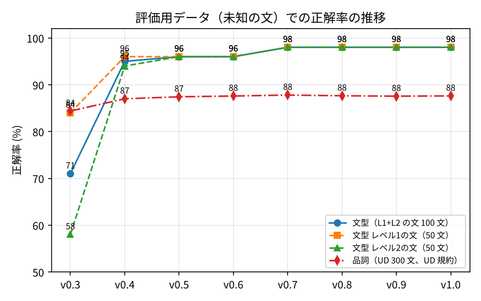

# English Structure Viewer

英文を入力すると、文構造（SVOC）・品詞・原形・訳語・構造訳（日本語）をブラウザ内だけで解析して可視化する Web アプリ。

- 公開 URL: https://224096-cmd.github.io/eng-structure-viewer/
- 評価モード: https://224096-cmd.github.io/eng-structure-viewer/eval.html
- サーバ・API キー不要。GitHub Pages 上の静的サイトとして動作し、解析はすべてルールベース。AI 翻訳は任意機能で、オンにした時だけ小型モデル（145 MB）をブラウザ内で実行。

## 構成
| パス | 内容 |
|---|---|
| `index.html`, `app.js`, `style.css` | 解析画面 |
| `eval.html`, `eval.js` | 評価モード（文型・品詞の一括評価、CSV/JSON 出力） |
| `src/pos.js` | 品詞タグ付け・原形 |
| `src/chunker.js` | チャンク化（名詞句・動詞句など） |
| `src/patterns.js` | 文型判定エンジン |
| `src/text.js` | 文分割・記号の正規化（長文対応） |
| `src/render.js` | 描画・ホバーカード |
| `src/dict.js` | 英和辞書の読み込み（EJDict-hand、CC0） |
| `src/tree.js` | 構造図（SVG） |
| `src/gloss.js` | 構造訳（日本語）: 役割と辞書から機械的に組み立てる |
| `src/mt.js` | AI 翻訳（任意）: ブラウザ内で FuguMT（ONNX, 約145MB）を実行 |
| `scripts/gloss_eval.mjs` | 構造訳の辞書カバー率と一覧出力 |
| `sw.js`, `manifest.json`, `icon.svg` | オフライン対応（PWA） |
| `scripts/evaluate.mjs` | 評価を一括実行して results/ に保存（`node scripts/evaluate.mjs v0.5`） |
| `scripts/make_figures.py` | 図の生成（`python scripts/make_figures.py`） |
| `rules/patterns.json` | 文型規則（level 付き） |
| `data/testset_dev.csv` | 開発用テストセット（169 文） |
| `data/testset_eval.csv` | 評価用テストセット（130 文・規則改良には使わない） |
| `data/dict/` | 英和辞書（頭文字ごとの JSON） |
| `data/passages_dev.json`, `passages_eval.json` | 長文テストセット（開発用 1 編、評価用 2 編） |
| `data/ud_ewt_sample.json` | 品詞評価用 UD English-EWT 抜粋（300 文、CC BY-SA 4.0） |
| `docs/annotation_guide.md` | テストセットのアノテーション仕様 |
| `docs/evaluation_protocol.md` | 評価手順と版ごとの記録 |
| `docs/architecture.md` | 処理の流れ・設計判断・既知の限界 |
| `docs/thesis_outline.md` | 卒業論文の骨子（章立てと表・図の対応） |
| `results/` | 評価結果（版ごとのフォルダ、`summary_all.csv`、`figures/`） |
| `vendor/compromise.js` | 品詞タグ付けライブラリ（MIT License） |

## 現在の精度（v1.0、評価用 130 文・長文 2 編・UD 300 文）
- 文型（短文）: 93.8%（レベル1の文 98%、レベル2の文 98%、レベル3の文 80%）
- 文型（入試長文、未知 2 編 33 文）: 70%（開発用 3 編 43 文は 100%）
- 品詞: 87.7%（UD 規約）、原形: 93.4%
- 構造訳の辞書カバー率: 99.8%（評価用 130 文の内容語）
- AI 翻訳（FuguMT q8）: 1 文 約 0.25 秒（CPU）、モデル 145 MB、初回のみダウンロード
- 速度: 約 2,000 語（120 文）を 0.5 秒（PC）

## 更新履歴
- v1.0 : 構造訳の訳語選択を修正（多義の区切り・活用形・句動詞・ハイフン語・IT 語彙）、AI 翻訳オン時は構造訳を自動で隠す、AI 翻訳の設定を記憶、見出しの翻訳改善。解析規則は v0.9 と同じ
- v0.9 : AI 翻訳（FuguMT をブラウザ内で実行、任意）、ハイフン語・所有格・due to・文頭不定詞・コンマ列挙などの改良、開発用長文 3 編目、翻訳方式の比較実験
- v0.8 : 構造訳（日本語）、見出しの扱い、コンマ付き関係詞節・複合名詞・as/like の判別など（ユーザー提供長文 11/11）、辞書を 4 義に拡張、ポスター
- v0.7 : 評価用の誤り項目に基づく規則拡張（不定詞の形容詞的用法・whether 節・強調構文・分詞構文など）、開発用 +34 文、卒論骨子。評価用 130 文: 93.8%、長文 73%
- v0.6 : 長文対応（略語・引用符を考慮した文分割、記号による句の区切り、引用・括弧・ダッシュ・同格・接触節・伝達の倒置など）、長文向け表示（文番号・文型別の絞り込み・構造図の折りたたみ）、長文テストセット
- v0.5 : レベル3規則（重文・分詞構文・関係副詞・what 節・間接疑問・倒置など）、訳語表示（EJDict-hand）、構造図（SVG）、オフライン対応、評価スクリプト・図の自動生成。評価用 130 文: 89.2%
- v0.4 : 疑問文・There is・等位接続主語・動名詞・使役知覚・分詞修飾・形式主語など規則拡張、開発用 +50 文、キャッシュ対策（?v=）。評価用 100 文: 71% → 95%
- v0.3 : 評価用テストセット 100 文（未知データ）、UD English-EWT による品詞・原形評価、評価プロトコル。規則は v0.2 から変更なし
- v0.2 : 品詞・原形のホバー表示、レベル付き文型規則（JSON）、S/V/O/C/M の色分け、評価モード、開発用テストセット 50 文
- v0.1 : 最小構成・Pages デプロイ確認
